# Pawprint Days (足印日記) — Baseline Visual, UX & Device QA Report

- **Date:** 2026-11-23
- **Branch:** `gemini/qa-baseline`
- **Device:** iPhone 18 Pro Simulator (`F839F388-C746-4C4E-9A82-AEB40A1ECC70`), iOS 27.2 (`402 × 874 pt`, `@2x` screenshots at `804 × 1748 px`)
- **Build:** `PawprintDays` scheme (`Debug-iphonesimulator`), zero source edits

---

## 1. Screen-by-Screen Inventory

| # | Screen / State | File / View | Key Observations | Screenshot |
|---|---|---|---|---|
| 1 | Onboarding — Page 1 (Welcome & 6 Companions) | `CozyOnboardingTutorialView` (`welcomePage`) | Warm cream canvas, animated `餘燼` & `杜松` rigs, washi-taped paper card. Generous empty space above page dots. | 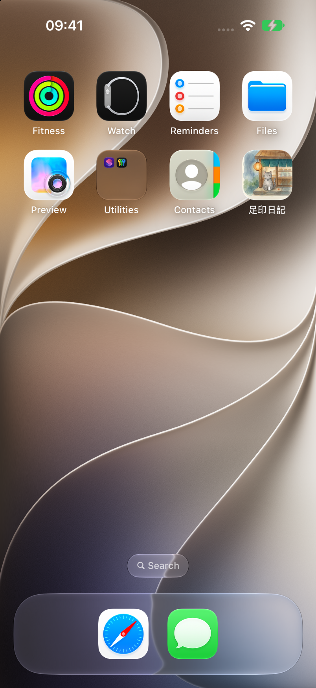 |
| 2 | Onboarding — Page 2 (Walking & Encounters) | `CozyOnboardingTutorialView` (`walkingGuidePage`) | Explains 75 m paw glow, greeting gestures, 200-step coin & 1,400-step pocket-find rules. `hand.raised.fill` reads as `"封鎖"` to VoiceOver. | 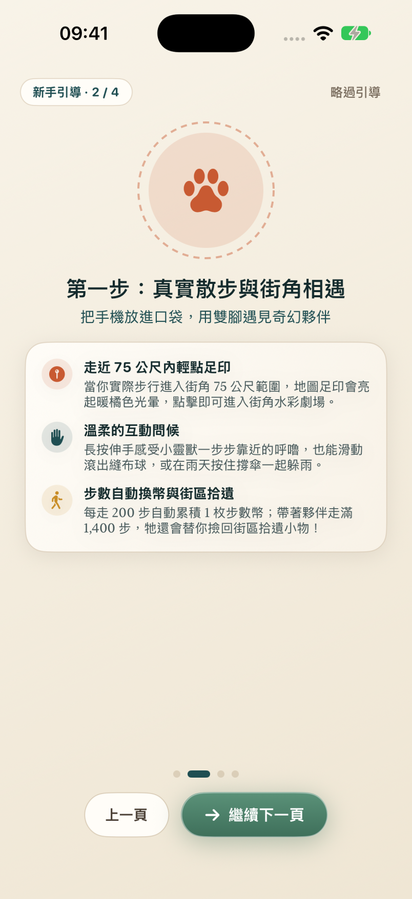 |
| 3 | Onboarding — Page 3 (2.5D Sunroom) | `CozyOnboardingTutorialView` (`sunroomGuidePage`) | Animated `梅子` & `蘆葦` rigs + 3 sunroom feature bullets. Clean card alignment. | 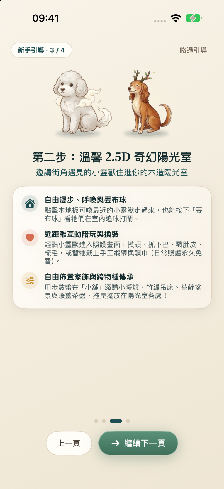 |
| 4 | Onboarding — Page 4 (Diary & Permissions) | `CozyOnboardingTutorialView` (`diaryAndPermissionsPage`) | Inline permission buttons (`開啟定位`, `連結計步`). Button flips to `"已開啟 ✓"` immediately on tap, before the OS dialog is answered. | 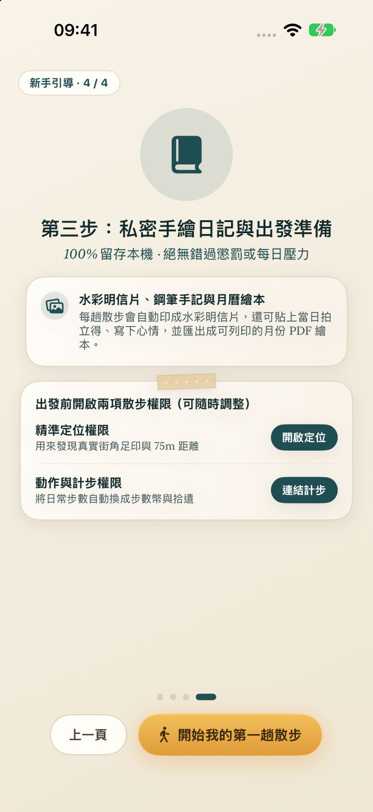 |
| 5 | Onboarding — iOS Location Prompt | `LocationService.requestForegroundLocation` | System prompt displays clear zh-Hant privacy rationale (`NSLocationWhenInUseUsageDescription`). | 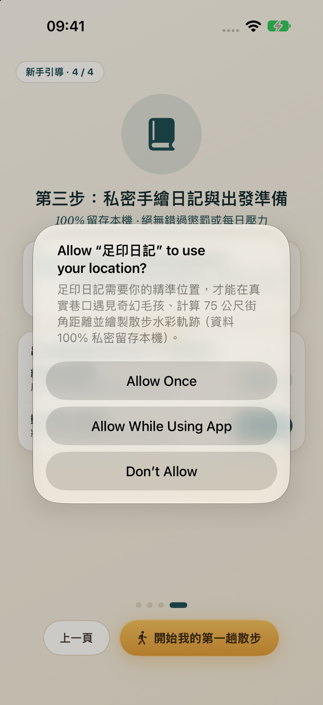 |
| 6 | Street Overworld — Initial State | `StreetOverworldView` | Top-left date pill wraps `"11月23日 星期一"` onto two lines while GPS pill truncates `"搜尋精準定位..."`; `麵包店巷口` at 41 m shows slate-teal instead of orange due to stale initial fix; `溪畔木椅 · 164m` clips at right edge. | 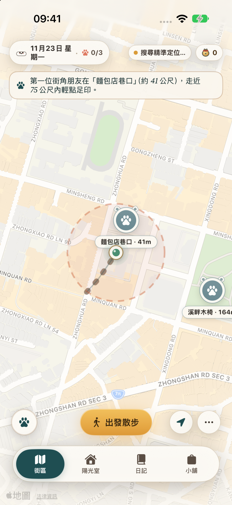 |
| 7 | Street Overworld — Corner Tools Popover | `StreetOverworldView` (`CozyPopoverMenuCard`) | First item truncates to `"前方 60m 釘選熟悉..."` inside fixed `214 pt` width card. | 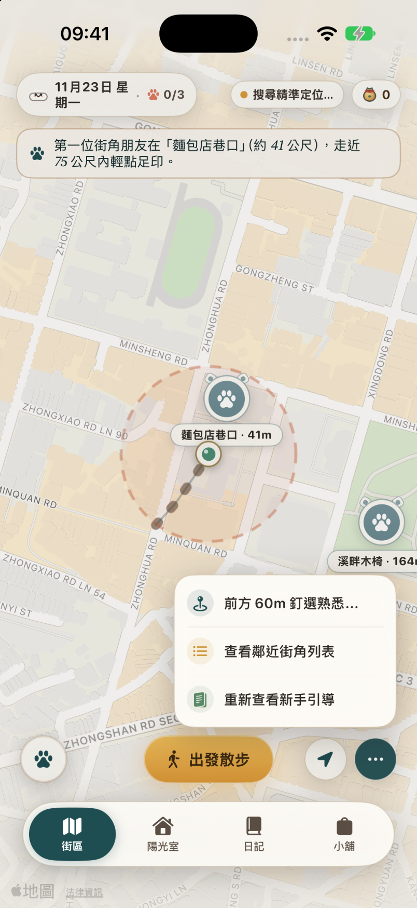 |
| 8 | Street Overworld — Nearby Corners List | `AccessibleNearbyListSheet` | Displays MapKit discovery button + corner cards. `麵包店巷口` at 41 m erroneously says `"41 公尺 · 需再走近一些"` when GPS fix is stale (`> 30 s`). | 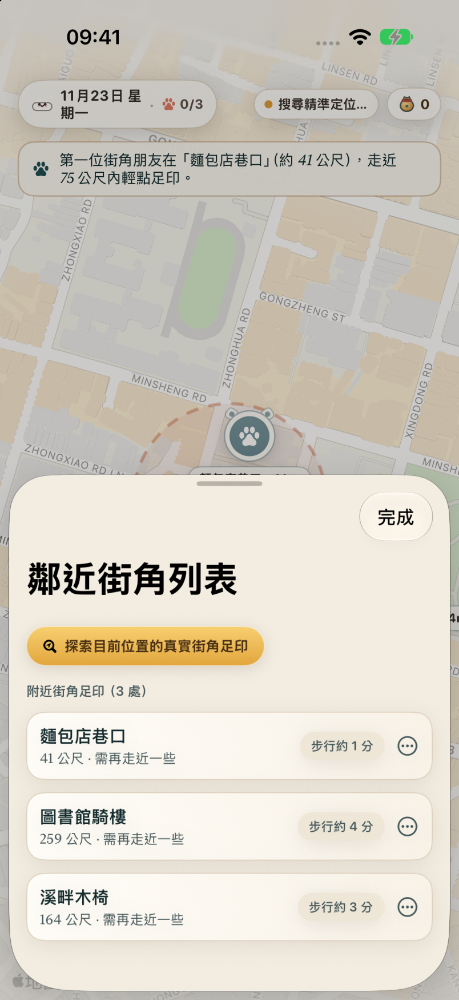 |
| 9 | Street Overworld — Start-Stroll & Satchel Sheet | `StartStrollSatchelSheet` | Clean hierarchy: step auto-sync callout, companion selector, free empty-handed option + 3 optional charms, primary `"繫好領巾，出發散步！"` CTA. | 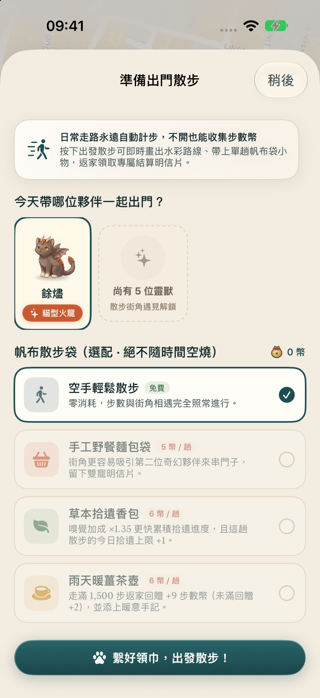 |
| 10 | Street Overworld — Active Stroll & Discovered POIs | `StreetOverworldView` | 4 stacked top banners consume ~38% of map height; duplicate `"回到家了"` CTAs (top banner + bottom hero); center pins pile onto player pin; `"DK Breathable Air Shoes Luodong Sto"` overflows screen right edge. | 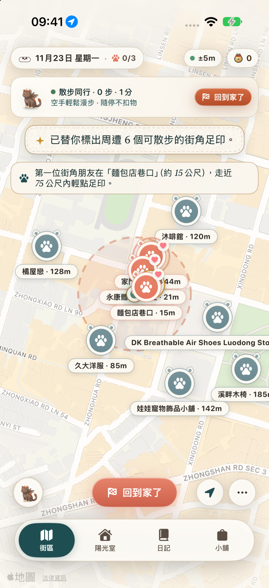 |
| 11 | Street Overworld — Location-Denied State | `StreetOverworldView` + `GameCoordinator+Progression` | On Simulator (`useSimulatedPosition == true`), `isStreetLocationUnavailable` stays `false` so encounters remain unlocked; GPS pill falsely reads `"開精準"` when `.denied`. | 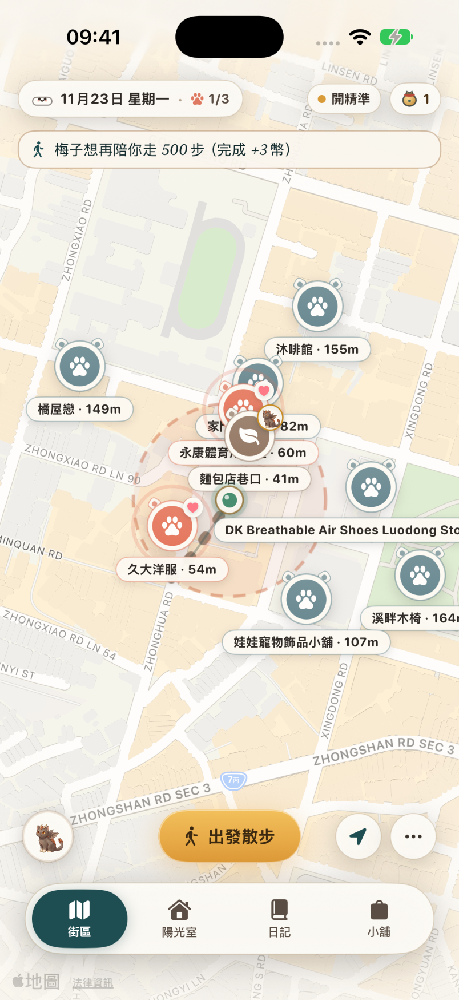 |
| 12 | Street Overworld — Corner Tapped While Location Denied | `SidewalkEncounterView` (`久大洋服`) | Enters full encounter with `杜松` despite `CLAuthorizationStatus.denied` because simulator fallback bypasses the gate. | 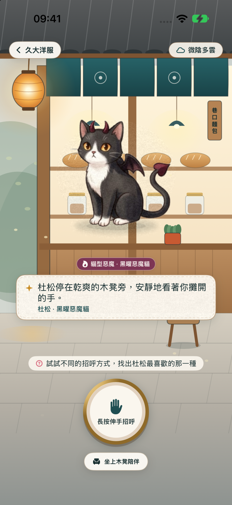 |
| 13 | Sidewalk Encounter — Greeting Stage | `SidewalkEncounterView` | Warm watercolor bakery facade, hanging lantern, `梅子` rig, brass 2.5 s hold medallion, `"坐上木凳陪伴"`, `"上滑或點擊滾布球"`. Badge repeats `"銀月星靈 · 銀月星靈犬"`. | 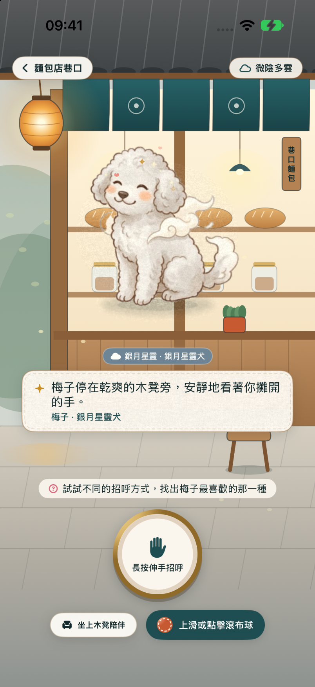 |
| 14 | Sidewalk Encounter — Post-Greeting & Postcard | `SidewalkEncounterView` | `"今日相遇 ✦"` stamp, narrative card, favorite-gesture hint, `+3 步數幣` walk quest banner, taped mini-postcard preview, dual departure buttons. |  |
| 15 | Home Sunroom — 2.5D Stage & Roaming | `HomeSunroomView` + `Sunroom25DStageView` | Parallax sunlight beams, wind chime, `杜松` peeking outside window (`窗外揮手 0/3`), `餘燼` & `梅子` roaming, hide-and-seek bubble. Edge stations (`摺紙桌`, `玄關背包`, `暖薑蜂蜜熱...`) clip off edges. | 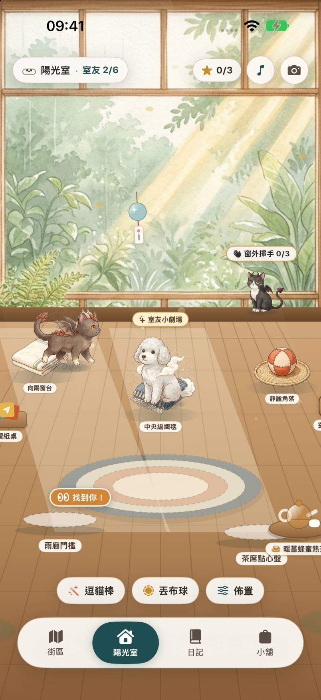 |
| 16 | Home Sunroom — Ball Toss | `HomeSunroomView` (`丟布球`) | Cloth ball rolls onto wood floor while roommates chase/react playfully. | 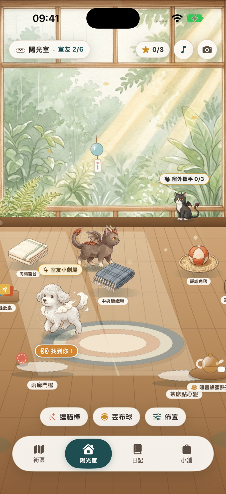 |
| 17 | Home Sunroom — Daily Wishes Sticky Slip | `InWorldWishStickySlip` | Inline floating sticky-note popover showing 3 daily wishes without a modal sheet. | 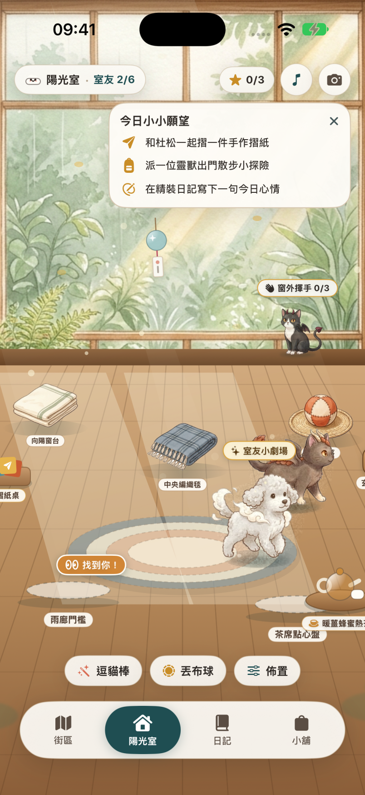 |
| 18 | Home Sunroom — In-World Origami Station | `InWorldOrigamiFoldOverlay` | Inline 3-swipe craft mat over floor. First recipe chip (`契約摺紙小星`) wraps to 2 lines, making its pill taller than siblings. | 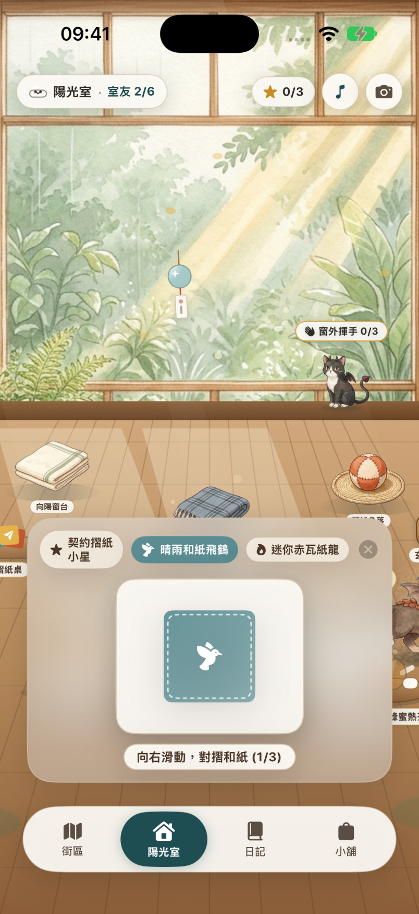 |
| 19 | Home Sunroom — Roommate Jump Drawer | `PetBookmarkJumpDrawer` | `.large` nav title truncates (`"布書籤 · 6 位奇幻鄰居..."`); starter pet `餘燼` displays `"尚未遇見 · 相伴 0 天"` alongside an active `"探望"` button. | 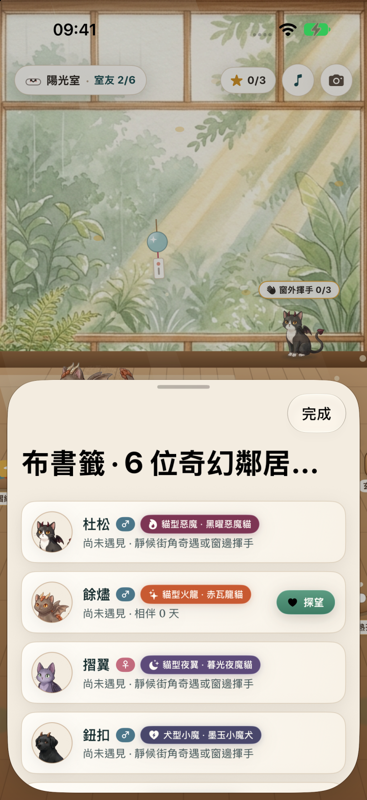 |
| 20 | Home Sunroom — Roaming Speech Bubble Edge Clip | `Sunroom25DStageView` | Speech bubble (`"...的雲朵一樣打滾♪"`) near left wall clips outside the viewport. | 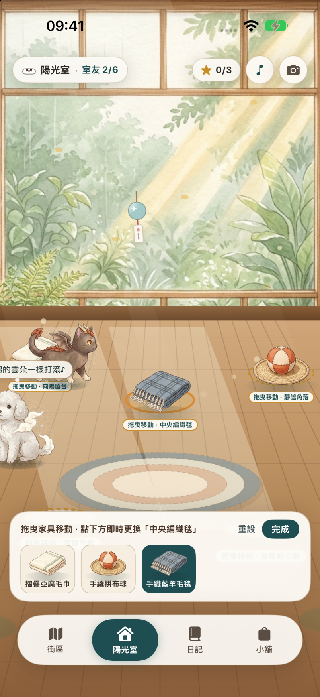 |
| 21 | Home Sunroom — Furniture Drag / Decorate Mode | `HomeSunroomView` (`isDecoratingMode`) | Live floor drag handles + bottom prop carousel. Lower floor labels (`雨廊門檻`, `茶席點心盤`) bleed visibly behind the translucent carousel card. | 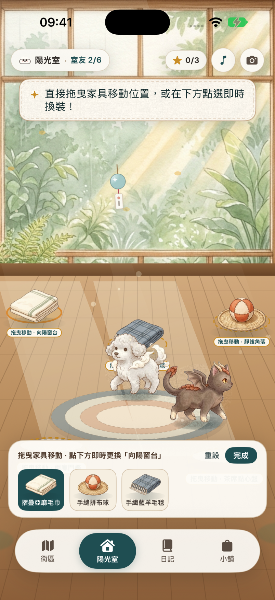 |
| 22 | Home Sunroom — Photo / Zen Mode | `HomeSunroomView` (`isSunroomPhotoMode`) | Hides top bar and bottom dock, but leaves all station labels (`向陽窗台`, `摺紙桌`, `茶席點心盤`, `窗外揮手 0/3`, `室友小劇場`) visible on screen. | 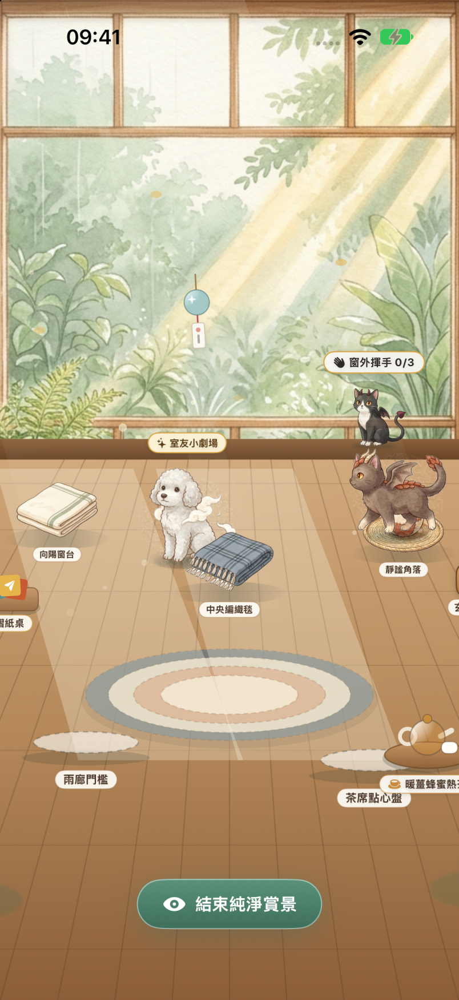 |
| 23 | Tactile Care — Interaction Tray | `TactileCareView` | Sunlight floor rug, 3-heart meter, prompt text over beige floor, `"互動陪玩"` tray. Rightmost `"同行中"` button is clipped horizontally; `餘燼` still shows `"尚未遇見 · 相伴 0 天"`. | 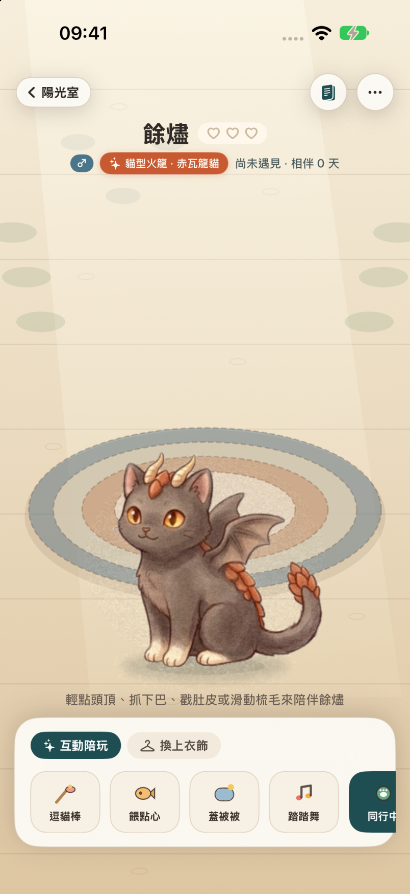 |
| 24 | Tactile Care — Wardrobe Tray | `TactileCareView` | Clean `"素頸自然"` card + `"前往小舖 ▸"` link when no outfits are owned yet. | 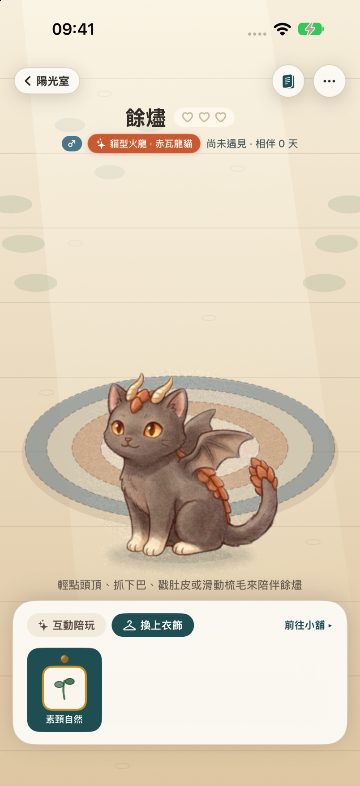 |
| 25 | Hardcover Sketchbook — Diary Pages | `HardcoverSketchbookView` | Left book-spine shadow, stitched cloth tabs, search + pet filter pills (`蘆` clips on right), taped watercolor postcard with `"掛進陽光室"` & `"珍藏分享"`, empty route box shows a flat dashed line. | 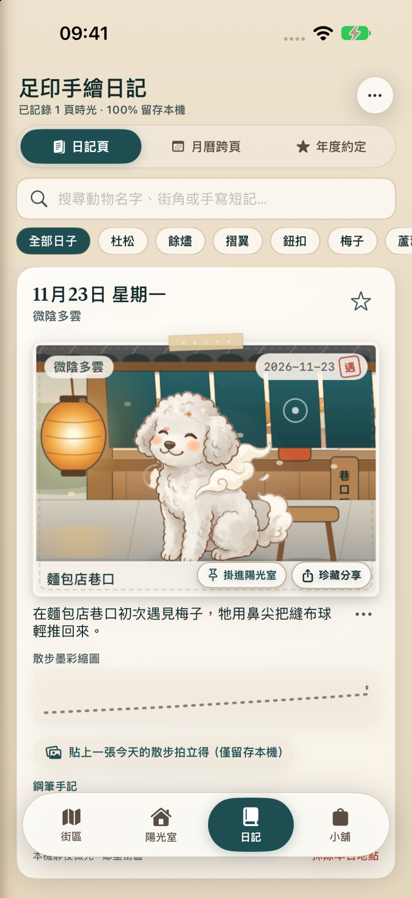 |
| 26 | Hardcover Sketchbook — Backup & Restore Popover | `HardcoverSketchbookView` | Clean `.json` share & import popover (`分享本機備份檔 (.json)`, `從備份檔還原手記`). | 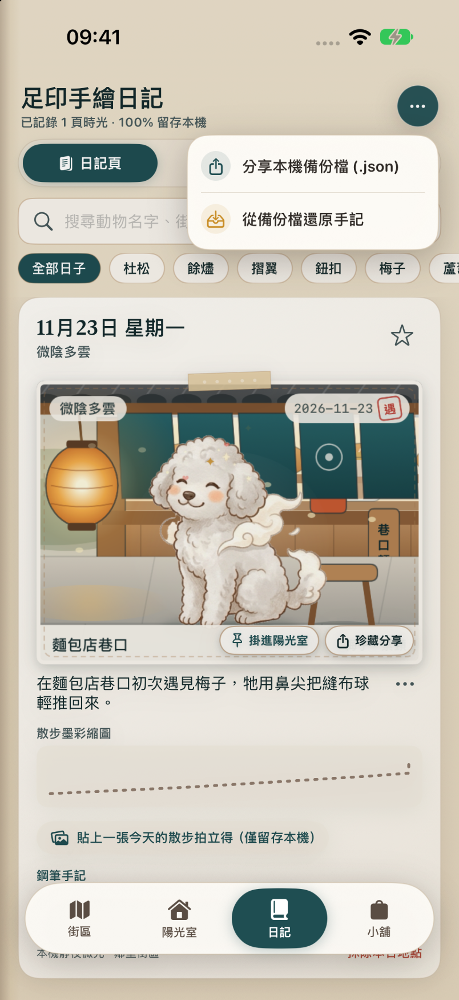 |
| 27 | Hardcover Sketchbook — Month Spread & PDF Export | `MonthSpreadGridView` | Clean 7-column calendar with weather dot + taped monthly summary + PDF export CTA. **Year header formats as `"2,026年11月"` with a grouping comma.** | 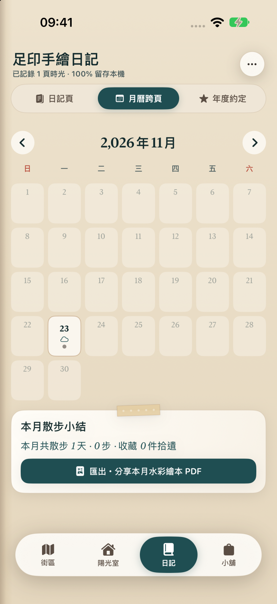 |
| 28 | Hardcover Sketchbook — Annual Traditions | `AnnualTraditionsRibbonView` | Calm empty-state card explaining how to star any diary page. | 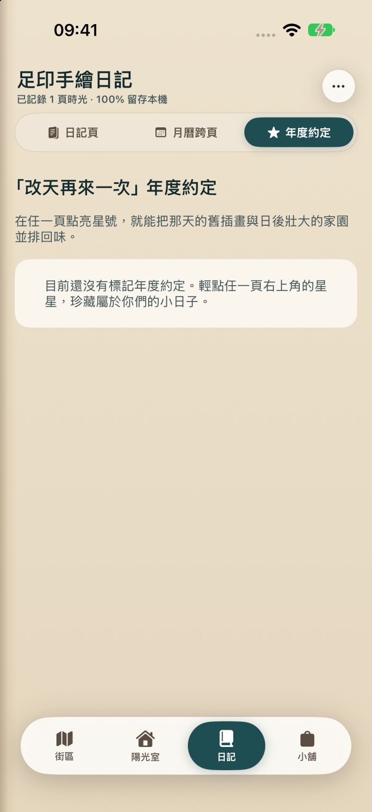 |
| 29 | Curio Cubbies — Compendium Default View | `CurioCubbiesView` | `showFullCompendium = true` by default fills 2+ screen heights with 16 grey undiscovered curio cards, burying the Coin Pouch & Shop CTA off-screen. | 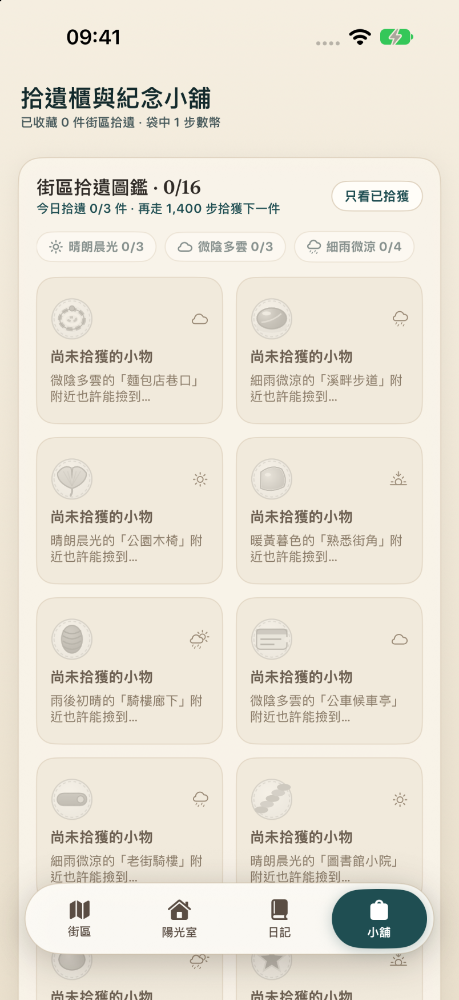 |
| 30 | Curio Cubbies — Collapsed View (Pouch & Shop CTA) | `CurioCubbiesView` | Once collapsed, layout is crisp: embroidered coin pouch, balance pill, `"打開街角紀念小舖"`, step sync, and collapsed settings row. | 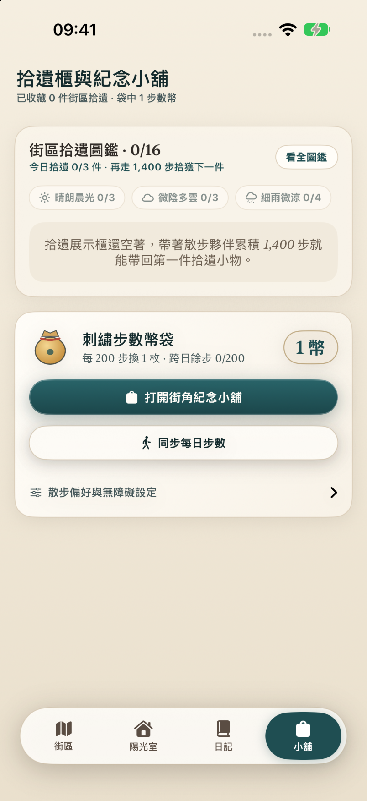 |
| 31 | Corner Memorial Shop Sheet | `CurioCubbiesView` (Shop Sheet) | Clean 5-category chips (`衣飾`, `家飾`, `行囊`, `茶點`, `屋景`), item cards with icons and coin pills. Opens at `.medium` detent initially. | 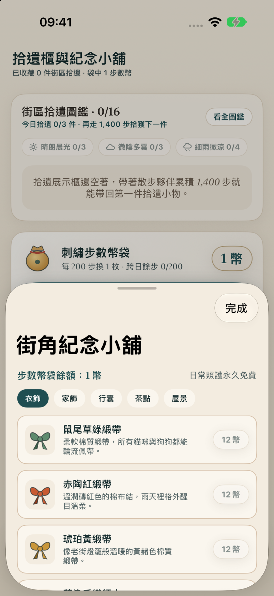 |
| 32 | Walking & Accessibility Settings | `CurioCubbiesView` (`DisclosureGroup`) | Sound, kalimba BGM, haptics, Mobility-Aid Roll Mode (`緩步里程與停留模式`), optional background visits, tutorial replay, and diary reset. | 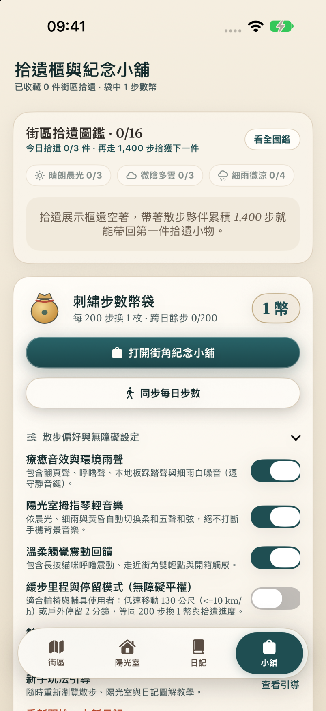 |
| 33 | Indoor Play Hub (Legacy Modal) | `IndoorPlayHubSheet` (`IndoorPlayHubSheet.swift`) | **Orphaned in current UI:** `IndoorPlayHubSheet` is never presented by any view; its features (`今日願望`, `茶點台`, `摺紙手作`, `靈獸探險`, `奇幻育兒`) now live as in-world Sunroom stations. | *(Not reachable in UI; verified via code grep)* |
| 34 | Accessibility Scan — Dynamic Type `AX2` (Street) | `StreetOverworldView` | Nearly all custom `AppTheme` & `.system(size:)` labels stay static under `accessibility-extra-large`. | 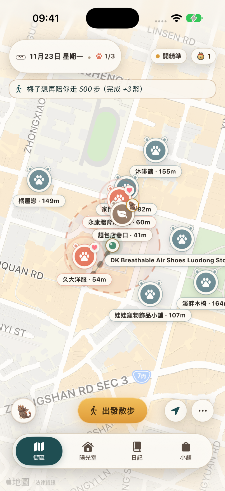 |
| 35 | Accessibility Scan — Dynamic Type `AX2` (Diary) | `HardcoverSketchbookView` | Only the native `TextField` / `magnifyingglass` icon scales up; all headings, tabs, pills, and body text ignore Dynamic Type. | 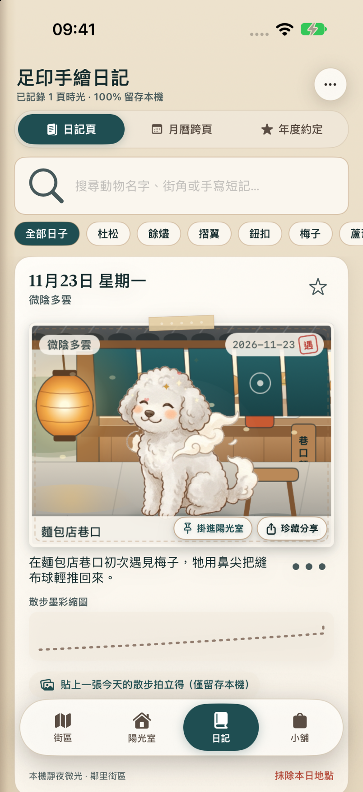 |

---

## 2. Bugs (Ranked by Severity)

### P1 — High

1. **Stale 30 s GPS Fix Gate Blocks a Nearby 41 m Corner & Misleads Player (`AnchorRotationEngine.swift` / `StreetOverworldView.swift`)**
   - **Repro:** Fresh-install app, spend >30 s reading onboarding (or wait 30 s before a new GPS fix arrives), dismiss onboarding onto `StreetOverworldView`, and open `"查看鄰近街角列表"`.
   - **Expected:** `麵包店巷口` at 41 m (inside the dashed 75 m circle) glows terracotta orange (`PawState.inRange`) and shows `"41 公尺 · 已在 75m 範圍內"` with a `"打招呼"` button.
   - **Actual:** `LocationService.init()` seeds `currentLocation` with `timestamp: Date()`. After `maxFixAgeSeconds = 30.0` (`AnchorRotationEngine.swift:16, 34-37`), `evaluateProximity` returns `.staleFix`, causing `pawState(for:)` (`GameCoordinator.swift:661-670`) to return `.distant` (slate-teal) while the hint banner still urges `"走近 75 公尺內輕點足印"`, and `AccessibleNearbyListSheet` (`StreetOverworldView.swift:917`) says `"41 公尺 · 需再走近一些"`.
   - **Evidence:** `05-street-overworld.png`, `07-nearby-list-sheet.png`.

2. **Location-Denied State Shows Misleading `"開精準"` Badge & Broken Simulator Guard (`StreetOverworldView.swift` / `GameCoordinator+Progression.swift`)**
   - **Repro:** Deny location permission (`CLAuthorizationStatus.denied`) and open `StreetOverworldView`.
   - **Expected:** Top-right GPS pill indicates location is off (`未開啟` / `未授權`) and routes to iOS Settings; `isStreetLocationUnavailable` triggers the indoor fallback hint (`"定位未開啟…"` + `"開啟設定"`). On Simulator, location-denied QA should match real-device gating when testing denied state.
   - **Actual:** Because iOS reports `accuracyAuthorization == .reducedAccuracy` when `.denied`, `StreetOverworldView.swift:135` displays `"開精準"` (yellow dot), and tapping it calls `requestWhenInUseAuthorization()` which iOS silently ignores after denial. Additionally, on Simulator `useSimulatedPosition` defaults to `true` (`LocationService.swift:39`), so `isStreetLocationUnavailable` (`GameCoordinator+Progression.swift:20`) returns `false` and lets the player enter `SidewalkEncounterView` even while `.denied`.
   - **Evidence:** `25-street-location-denied.png`, `25b-location-denied-tap-corner.png`.

3. **Photo / Zen Mode (`純淨賞景模式`) Leaves Floating Station Labels On-Screen (`HomeSunroomView.swift` / `Sunroom25DStage.swift`)**
   - **Repro:** Open `陽光室` and tap the top-right camera button (`純淨賞景模式`).
   - **Expected:** A clean, distraction-free scenic view of the sunroom and pets with only the `"結束純淨賞景"` exit pill.
   - **Actual:** All station pills (`向陽窗台`, `中央編織毯`, `靜謐角落`, `雨廊門檻`, `茶席點心盤`, `暖薑蜂蜜熱...`, `摺紙桌`, `室友小劇場`, `窗外揮手 0/3`) remain visible on screen.
   - **Evidence:** `15-sunroom-photo-mode.png`.

### P2 — Medium

4. **Calendar Year Renders With Thousands Comma: `"2,026年11月"` (`HardcoverSketchbookView.swift:421`)**
   - **Repro:** Open `日記` → `月曆跨頁`.
   - **Expected:** `"2026年11月"`.
   - **Actual:** `Text("\(displayedYear)年\(displayedMonth)月")` formats the `Int` using locale grouping, rendering `"2,026年11月"`.
   - **Evidence:** `20-diary-month-pdf.png`.

5. **Map Pin Collision & Unbounded POI Label Overflow (`StreetOverworldView.swift:745-875`)**
   - **Repro:** Trigger MapKit anchor discovery at Luodong (`24.67737, 121.76690`).
   - **Expected:** Nearby corners remain legible without overlapping the player pin or clipping off-screen.
   - **Actual:** Three in-range pins (`麵包店巷口`, `家門口轉角`, `永康體育用品社`) stack on top of each other and cover the player lantern; `PawAnchorStampView` uses `.fixedSize()` (`line 845`) with no `lineLimit` or max width, causing `"DK Breathable Air Shoes Luodong Sto"` and `"溪畔木椅 · 164m"` to clip off the right screen edge.
   - **Evidence:** `09-street-active-stroll.png`, `25-street-location-denied.png`.

6. **Starter Companion `餘燼` Displays `"尚未遇見 · 相伴 0 天"` (`HomeSunroomView.swift:636` / `TactileCareView.swift:118`)**
   - **Repro:** Open `陽光室` → tap `陽光室 · 室友 2/6` drawer, or tap `餘燼` to enter `TactileCareView`.
   - **Expected:** Starter roommate displays a welcoming starter status (e.g. `"陽光室小室友 · 第 1 天"`).
   - **Actual:** `餘燼` (`milestoneTier == 0`, `sharedDaysCount == 0`) shows `"尚未遇見 · 相伴 0 天"` even though it is already living in the sunroom and has a `"探望"` button.
   - **Evidence:** `13d-roommate-drawer.png`, `16-tactile-care.png`.

7. **Onboarding Permission Buttons Falsely Show `"已開啟 ✓"` / `"已連結 ✓"` Before Consent (`CozyOnboardingTutorialView.swift:337, 363`)**
   - **Repro:** On Onboarding Page 4, tap `"開啟定位"` or `"連結計步"`, then tap `"Don’t Allow"` on the system prompt.
   - **Expected:** Button only transitions to `"已開啟 ✓"` once permission is actually granted.
   - **Actual:** `requestedLocation = true` / `requestedMotion = true` flips the button label optimistically to `"已開啟 ✓"` / `"已連結 ✓"` immediately upon tap regardless of the user's answer.

8. **Duplicate Primary `"回到家了"` Button & 4-Row Top Banner Stack During Strolls (`StreetOverworldView.swift:174-223, 474-481`)**
   - **Repro:** Start a stroll (`出發散步` → `繫好領巾，出發散步！`) while discovery/whisper banners are active.
   - **Expected:** One clear end-stroll CTA and compact top HUD leaving the map visible.
   - **Actual:** `"回到家了"` appears both inside the top stroll banner and as the bottom terracotta hero CTA; combined with the top pills, whisper slip, and goal hint, 4 stacked cards cover the top ~38% of the map.
   - **Evidence:** `09-street-active-stroll.png`.

9. **Orphaned `IndoorPlayHubSheet` Dead Code (`IndoorPlayHubSheet.swift:144`)**
   - **Repro:** Search codebase for `IndoorPlayHubSheet`.
   - **Expected:** Either reachable from the UI or removed/archived if superseded by in-world stations.
   - **Actual:** `IndoorPlayHubSheet` is never instantiated anywhere in `PawprintDays/` (only helper views `HybridOffspringRigView`, `GlowingMysticalEggView`, etc. from the same file are used).

### P3 — Low

10. **Sunroom In-World Station Labels & Roaming Speech Bubbles Clip at Screen Edges (`HomeSunroomView` / `Sunroom25DStageView`)**
    - **Repro:** Open `陽光室` at default pan (`panOffset == 0`) and observe left/right edges or wait for a pet to speak near the left wall.
    - **Actual:** `摺紙桌` clips on the left edge, `玄關背包` clips to `"玄"` and `"暖薑蜂蜜熱..."` clips on the right edge, and pet speech bubbles near `x ≈ 0` clip off the left edge (`"...的雲朵一樣打滾♪"`).
    - **Evidence:** `12-home-sunroom.png`, `13e-sunroom-speech-clipped.png`.

11. **Sunroom Tap-Target Drift Between Roaming Pets and Floor Furniture (`HomeSunroomView.swift:63-88`)**
    - **Repro:** Tap a moving roommate in `陽光室` right as it walks off a furniture spot.
    - **Actual:** Tapping slightly behind a walking pet hits the underlying floor spot (`onTapSpot`), unexpectedly entering `Decorate Mode` instead of opening `TactileCareView`.

12. **Text Truncation in Popovers, Drawers, and Origami Chips**
    - `CozyPopoverMenuCard` (`CozyUnifiedUI.swift:265`) fixed `width: 214` truncates `"前方 60m 釘選熟悉..."` (`06-street-tools-popover.png`).
    - `PetBookmarkJumpDrawer` `.large` title truncates `"布書籤 · 6 位奇幻鄰居..."` (`13d-roommate-drawer.png`).
    - `InWorldOrigamiFoldOverlay` `"契約摺紙小星"` chip wraps onto 2 lines while siblings stay 1 line (`13c-sunroom-origami.png`).
    - `TactileCareView` action tray clips `"同行中"` on the right edge (`16-tactile-care.png`).

---

## 3. Visual Consistency Issues (Watercolor-Stationery Style)

- **Typography & Wrapping:**
  - `StreetOverworldView` top-left date pill wraps `"11月23日 星期一"` mid-word (`星\n期一`) whenever the adjacent GPS pill expands to `"搜尋精準定位..."` (`05-street-overworld.png`).
  - `HardcoverSketchbookView` Month Spread formats the year with a grouping comma (`"2,026年11月"`), breaking the clean storybook calendar aesthetic (`20-diary-month-pdf.png`).
  - `SidewalkEncounterView` species badge repeats `"銀月星靈 · 銀月星靈犬"` (`10-sidewalk-encounter.png`), and `TactileCareView` / `PetBookmarkJumpDrawer` say `"尚未遇見"` for the player's own starter pet.
- **Spacing, Clipping & Layer Bleed:**
  - In `HomeSunroomView` (`14-sunroom-decorate.png`), lower floor drag handles (`雨廊門檻`, `茶席點心盤`) bleed visibly through the translucent bottom furniture carousel card.
  - Edge stations (`摺紙桌`, `玄關背包`, tea tray chip) sit right on the horizontal bezel at `panOffset == 0` (`12-home-sunroom.png`).
  - `HardcoverSketchbookView` empty ink-route container shows only a flat dashed horizontal line (`散步墨彩縮圖`), looking unfinished when a stroll has <2 GPS points (`18-diary-pages.png`).
- **Contrast & Legibility:**
  - In `TactileCareView` (`16-tactile-care.png`), `"輕點頭頂、抓下巴、戳肚皮或滑動梳毛來陪伴餘燼"` uses `#46585A` directly over textured wood grain without a paper pill backdrop, lowering outdoor legibility compared to other screens.
- **Safe Areas & Dynamic Island:**
  - Top bars across Onboarding (`01-onboarding-p1.png`), Street (`05-street-overworld.png`), Encounter (`10-sidewalk-encounter.png`), Sunroom (`12-home-sunroom.png`), Care (`16-tactile-care.png`), Diary (`18-diary-pages.png`), and Shop (`22-curio-cubbies.png`) clear the Dynamic Island and status bar cleanly with zero overlap.
  - Bottom `CozyFloatingDockBar` leaves ~86 pt clearance on Street/Sunroom, though on `Diary` and `CurioCubbies` the scroll content passes right behind the dock pill without extra bottom padding fade (`18-diary-pages.png`, `22-curio-cubbies.png`).

---

## 4. UX Friction (First 10 Minutes & Location-Denied Path)

### First 10 Minutes (New Player Funnel)
1. **Shop Tab First Impression (`22-curio-cubbies.png`):** Tapping `小舖` opens directly onto 16 grey `"尚未拾獲的小物"` cards (`showFullCompendium = true`). The Coin Pouch, `"打開街角紀念小舖"` CTA, step sync, and accessibility settings are buried ~2 screens below, making the Shop tab look empty/broken to a new player.
2. **Stale Initial Location Trap (`05-street-overworld.png`, `07-nearby-list-sheet.png`):** If a user reads the 4 onboarding pages for >30 s before real GPS arrives, their 41 m doorstep/bakery corner turns slate-teal (`distant`) and says `"需再走近一些"`, creating immediate confusion about why they can't tap the nearby pin.
3. **4-Page Text-Heavy Onboarding (`01`–`04`):** Onboarding relies on dense bullet cards rather than letting the player try one quick tactile gesture (or jump straight to a 1-tap doorstep encounter).
4. **Sunroom Discovery Overload (`12-home-sunroom.png`):** First arrival in `陽光室` presents 10+ simultaneous floating pills (`窗外揮手`, `室友小劇場`, `找到你！`, `向陽窗台`, `摺紙桌`, `玄關背包`, `暖薑蜂蜜熱...`, `茶席點心盤`, `逗貓棒`, `丟布球`, `佈置`) with edge clipping on both sides.

### Location-Denied Path
1. **Dead-End GPS Pill (`25-street-location-denied.png`):** When permission is `.denied`, the top-right pill reads `"開精準"` instead of `"未授權 / 開啟設定"`, and tapping it triggers a no-op `requestWhenInUseAuthorization()` instead of opening Settings.
2. **Indoor Path Discoverability:** When street walking is blocked by denied location, `nextGoalHint` mentions window waving and errands (`GameCoordinator+Progression.swift:332`), but the player gets no direct button to jump straight to `陽光室` from that banner—only `"開啟設定"`.
3. **Simulator Masking (`LocationService.swift:39`):** Because `useSimulatedPosition` defaults to `true` on Simulator, QA and developers testing `"Don't Allow"` in Simulator still get `isStreetLocationUnavailable == false` and unrestricted corner encounters (`25b-location-denied-tap-corner.png`).

---

## 5. Quick Accessibility Scan

### VoiceOver & Semantics
- **Strong baseline coverage on primary dock & Sunroom props:** Main tabs (`街區`, `陽光室`, `日記`, `小舖`), map pins (`麵包店巷口，距離 41 公尺`), Sunroom stations (`輕撥江戶風鈴`, `陽光室摺紙手作桌`, `手沖茶盤…`), and Mobility-Aid Roll Mode toggle (`緩步里程與停留模式`) have clear zh-Hant accessibility labels.
- **Gaps observed in XCTest / AX snapshots:**
  1. **Unlabelled SF Symbol in Onboarding (`02-onboarding-p2.png`):** `hand.raised.fill` inside `tutorialBullet` (`CozyOnboardingTutorialView.swift:386`) has no `.accessibilityHidden(true)`, so VoiceOver announces it literally as `"封鎖"` ("Block") right before `"溫柔的互動問候"`. Similarly, `04-onboarding-p4.png` announces `"闔上的書本，填滿"` and `"傾斜矩形上的照片"`.
  2. **Modal Accessibility Bleed (`02`, `03`, `04` snapshots):** While `CozyOnboardingTutorialView` is presented in `.fullScreenCover`, all underlying `StreetOverworldView` map pins, top pills, and bottom dock tabs (`@e1`–`@e29`) remain visible in the accessibility tree (missing `.accessibilityViewIsModal(true)` or hidden backdrop).
  3. **Gesture Controls Exposed as Non-Button Roles (`10-sidewalk-encounter.png`):** In `SidewalkEncounterView`, the 2.5 s hold medallion exposes as `[image]` (`@e13`) and `"向上滑動或輕點滾出縫布球給梅子"` exposes as `[text]` (`@e16`) rather than `[button]` + `.accessibilityHint` / adjustable actions.
  4. **Missing Accessibility Labels on Custom Icon Badges (`13d-roommate-drawer.png`, `16-tactile-care.png`):** Pet gender symbol (`♂` / `♀`), care heart icons (`@e6..@e8` all read `"喜愛"` with no `"照護進度 0/3"` summary), and `CuteWeatherFaceIcon` lack grouped semantic summaries.

### Dynamic Type (`accessibility-extra-large` / `AX2`)
- **Non-scaling Typography (`26-a11y-large-text-street.png`, `27-a11y-large-text-diary.png`):** `AppTheme.swift` defines `serifTitle(_:)`, `serifBody(_:)`, `handwritten(_:)`, and `diegeticLabel(_:)` using fixed `.system(size:)` points, and views use `.system(size: ...)` directly. Under `AX2`, **only** the native `TextField` / `magnifyingglass` icon in `HardcoverSketchbookView` scaled up; all titles, buttons, cards, and tabs remained frozen at default size.

---

## 6. Top 10 Recommendations (Ranked)

1. **Fix `AnchorRotationEngine.evaluateProximity` Stale-Fix Handling on Initial/Cached Location (P1):** Don't mark an initial/waiting location as `.distant` solely from a 30 s `timestamp` timer when `useSimulatedPosition` is active or no newer fix has arrived yet; distinguish `.staleFix` from `.tooFar` in UI copy (`"定位更新中…"` rather than `"需再走近一些"`).
2. **Fix Location-Denied Handling & Simulator Parity (P1):** Check `authorizationStatus == .denied || .restricted` *before* `isReducedAccuracy` in `StreetOverworldView.swift:134-140` so the pill shows `"定位未開"` and links to `UIApplication.openSettingsURLString`; add a `"前往陽光室"` shortcut on the location-unavailable banner; ensure `isStreetLocationUnavailable` reflects `.denied` cleanly even on Simulator.
3. **Make `純淨賞景模式` (Photo Mode) Actually Pure (`HomeSunroomView.swift` / `Sunroom25DStage.swift`) (P1):** Hide all station pills, `"室友小劇場"`, `"找到你！"`, and `"窗外揮手 0/3"` badges whenever `coordinator.isSunroomPhotoMode == true`.
4. **Fix `"2,026年11月"` Number Grouping Bug in Month Spread (`HardcoverSketchbookView.swift:421`) (P2):** Format with `String(format: "%d年%d月", displayedYear, displayedMonth)` or `.formatted(.number.grouping(.never))`.
5. **Prevent Map Pin Label Overflow & De-clutter Overlapping Pins (`StreetOverworldView.swift:745-875`) (P2):** Add `frame(maxWidth: 150)` + `.lineLimit(1)` + `.truncationMode(.tail)` on `PawAnchorStampView` labels (removing `.fixedSize()`), and collapse duplicate `"回到家了"` CTA into one control + merge/compact the 4-row active-stroll top stack.
6. **Flip `CurioCubbiesView.showFullCompendium` Default to `false` (or Move Pouch & Shop Above Compendium) (P2):** Put the Embroidered Coin Pouch, `"打開街角紀念小舖"`, and step-sync controls immediately visible at the top of the `小舖` tab (`22b-curio-pouch-settings.png`), with the 16-card compendium expandable below.
7. **Fix Starter Pet Status & Duplicate Species Copy (`HomeSunroomView.swift:636`, `TactileCareView.swift:118`, `SidewalkEncounterView.swift:542`) (P2):** Show `"陽光室夥伴 · 第 1 天"` instead of `"尚未遇見 · 相伴 0 天"` for starter `餘燼` (`inviteState == .invitedHome && sharedDaysCount == 0`), and avoid repeating `"銀月星靈 · 銀月星靈犬"`.
8. **Only Mark Onboarding Permissions `"已開啟 ✓"` / `"已連結 ✓"` After Real Grant & Isolate Modal AX Tree (`CozyOnboardingTutorialView.swift`) (P2):** Bind button state to actual `authorizationStatus` / `ledger.pedometerOptIn`, add `.accessibilityViewIsModal(true)` on the onboarding cover, and mark decorative `tutorialBullet` SF Symbols `.accessibilityHidden(true)`.
9. **Support Dynamic Type Across `AppTheme` & Core Views (Accessibility) (P2):** Replace fixed `.system(size:)` helpers in `AppTheme.swift` with `@ScaledMetric` or semantic SwiftUI `Font.TextStyle` (`title2`, `body`, `callout`, `caption`), and use `ViewThatFits` / adaptive pill widths so `CozyPopoverMenuCard`, `PetBookmarkJumpDrawer`, and `InWorldOrigamiFoldOverlay` never truncate or wrap unevenly.
10. **Clean Up Sunroom Edge Margins, Decorate Bleed-Through & Orphaned `IndoorPlayHubSheet` (P3):** Inset default-pan station positions (`摺紙桌`, `玄關背包`, tea tray) + clamp roaming speech bubbles away from `x = 0` / `width`, hide non-selected spot labels behind the Decorate carousel, add a subtle paper pill behind `TactileCareView`'s instruction text, and either remove `IndoorPlayHubSheet` (`IndoorPlayHubSheet.swift:144`) or wire it cleanly if still intended.
